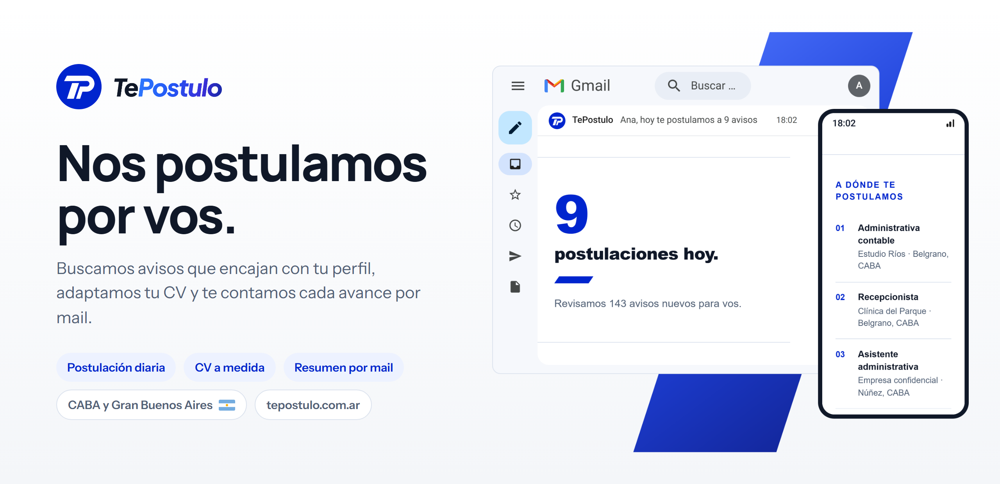
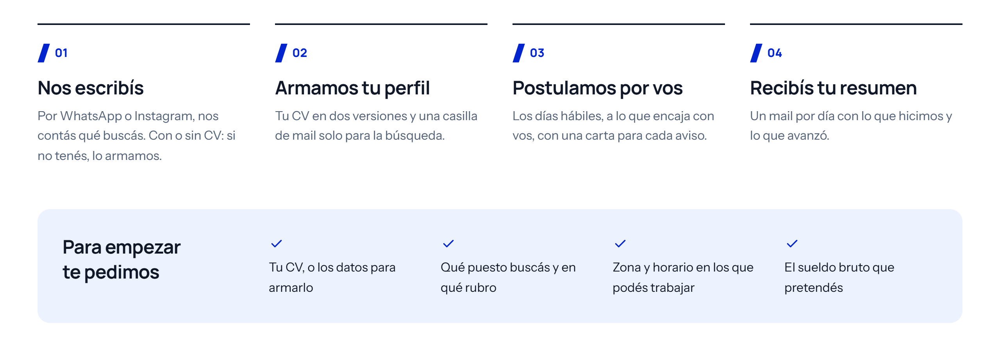
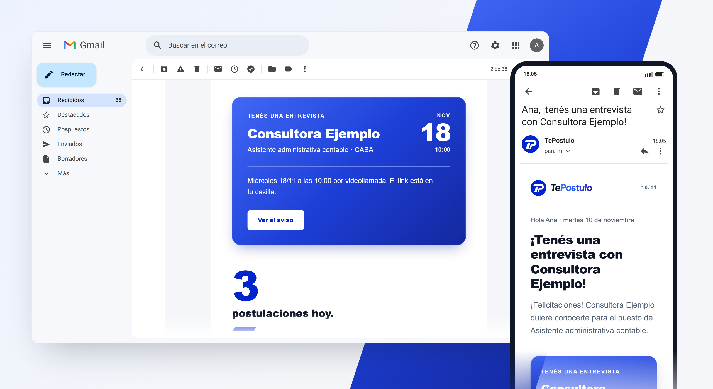
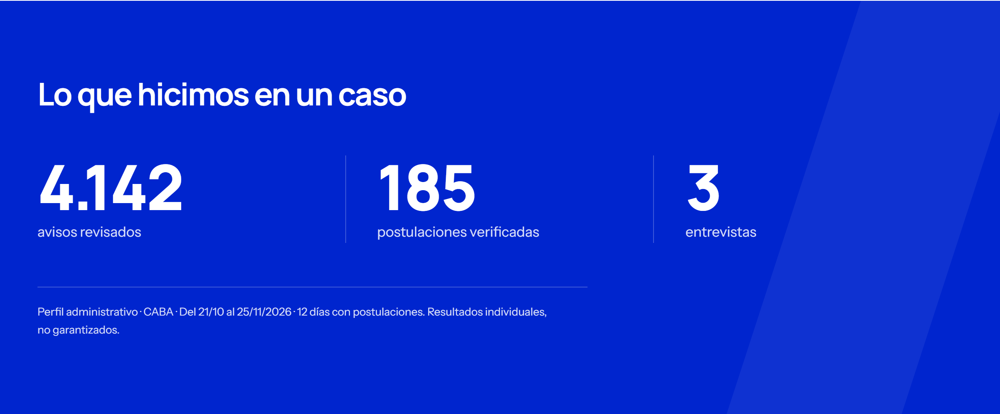
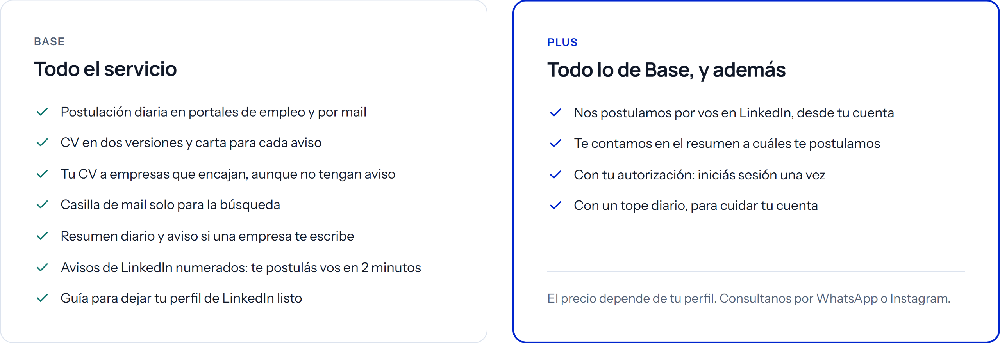

<a href="https://tepostulo.com.ar"></a>

<p align="center">
  <a href="https://tepostulo.com.ar"></a>
  <a href="https://wa.me/5491134861995?text=Hola%2C%20quiero%20saber%20c%C3%B3mo%20funciona%20TePostulo%20para%20mi%20perfil."></a>
  <a href="https://www.instagram.com/te.postulo/"></a>
</p>

<h3 align="center">Buscar trabajo te lleva horas todos los días. Dejanos esa parte a nosotros.</h3>

<p align="center">
  TePostulo se postula por vos a los avisos que encajan con tu perfil, en CABA y Gran Buenos Aires.<br>
  Vos seguís con tu día: cada tarde te llega un mail con todo lo que hicimos y lo que avanzó.
</p>

---

## Lo que hacemos por vos

| | |
| :-- | :-- |
| 🎯 **Avisos que encajan** | Filtramos por rubro, zona, horario y sueldo. Si un aviso nos genera dudas, te consultamos antes. |
| 📄 **Tu CV, a medida** | Dos versiones de tu CV y una carta pensada para cada aviso. Si no tenés CV, lo armamos con vos. |
| ✅ **Postulaciones verificadas** | Solo contamos una postulación cuando quedó confirmada. Nada de números inflados. |
| 📬 **Una casilla solo para tu búsqueda** | Las respuestas de las empresas no se pierden entre tus mails, y te avisamos apenas alguien te escribe. |
| 🔗 **LinkedIn incluido** | Te dejamos los avisos listos para postularte en 2 minutos. Con el plan Plus, nos postulamos por vos desde tu cuenta. |

## Cómo funciona



## Todo lo que hacemos, en un mail por día



Cada día hábil te llega un resumen claro, que se lee en un minuto desde el celular:

- **A dónde te postulamos**, con empresa y zona.
- **Qué empresas se movieron:** quién vio tu CV, quién avanzó y quién te llamó.
- **Tus entrevistas**, destacadas con el día y la hora.
- **Qué tenés que hacer vos**, solo si hay algo. Si no hay nada, te lo decimos: seguimos nosotros.

<sub>Los mails de las imágenes usan datos ficticios.</sub>

## Resultados reales



## Dos planes: Base y Plus



El precio depende de tu perfil. Escribinos y te contamos cuántos avisos hay para lo que buscás antes de empezar.

## Empezá hoy

<table>
  <tr>
    <td align="center" width="33%"><a href="https://wa.me/5491134861995?text=Hola%2C%20quiero%20saber%20c%C3%B3mo%20funciona%20TePostulo%20para%20mi%20perfil."><b>WhatsApp</b></a><br><sub>Contanos qué trabajo buscás</sub></td>
    <td align="center" width="33%"><a href="https://www.instagram.com/te.postulo/"><b>Instagram</b></a><br><sub>@te.postulo</sub></td>
    <td align="center" width="33%"><a href="https://tepostulo.com.ar"><b>tepostulo.com.ar</b></a><br><sub>Todo el servicio y las preguntas frecuentes</sub></td>
  </tr>
</table>

<p align="center"><b>Nos postulamos por vos.</b> · CABA y Gran Buenos Aires</p>

---

<details>
<summary><b>Sobre este repositorio</b></summary>

<br>

Este repositorio tiene el código del sitio público [tepostulo.com.ar](https://tepostulo.com.ar), una landing de una página con
política de privacidad.

| | |
| --- | --- |
| Stack | Next.js 16 · React 19 · TypeScript · Tailwind CSS v4 |
| Deploy | Vercel, con el dominio propio `tepostulo.com.ar` |
| Calidad | ESLint, chequeo de tipos, accesibilidad WCAG 2.2 AA y Lighthouse |

```bash
git clone https://github.com/sabbracciavento/te-postulo.git
cd te-postulo
npm install
cp .env.example .env.local   # NEXT_PUBLIC_WHATSAPP_NUMBER y NEXT_PUBLIC_SITE_URL
npm run dev                  # http://localhost:3000
```

Los textos viven en `src/content/`, los tokens de diseño en `src/app/tokens.css` y los componentes en `src/components/`.

</details>

<sub>Diseño y desarrollo: [Santiago Abbracciavento](https://github.com/sabbracciavento). El código se publica bajo licencia
[MIT](LICENSE). La marca, los textos y las imágenes de TePostulo no están cubiertos por esa licencia. Las tipografías Manrope e
Instrument Sans se distribuyen bajo la SIL Open Font License.</sub>
