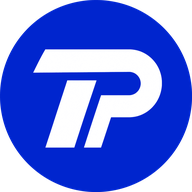
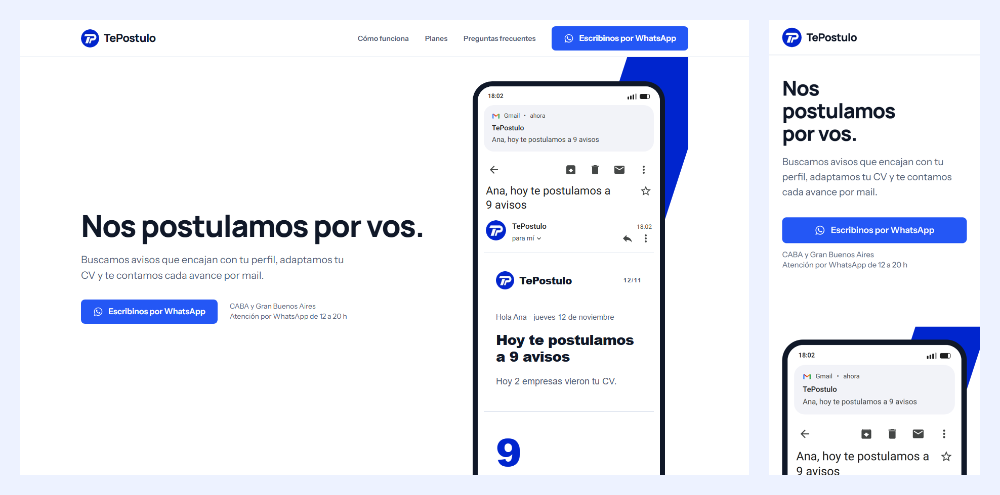
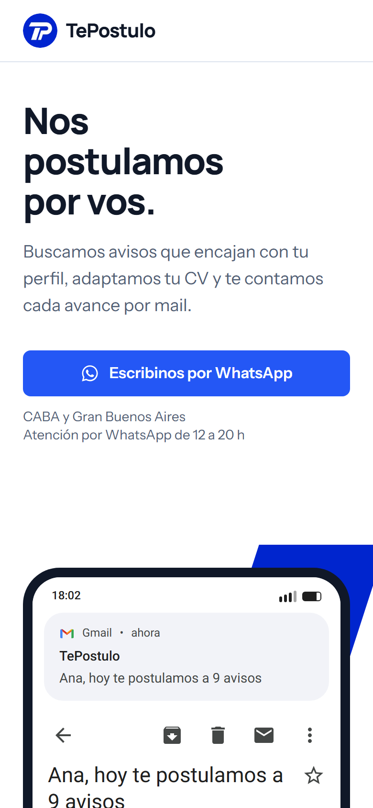
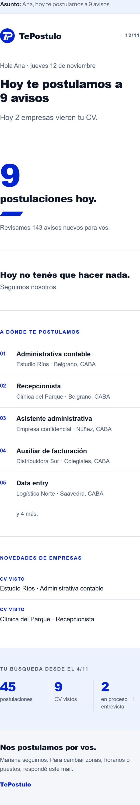
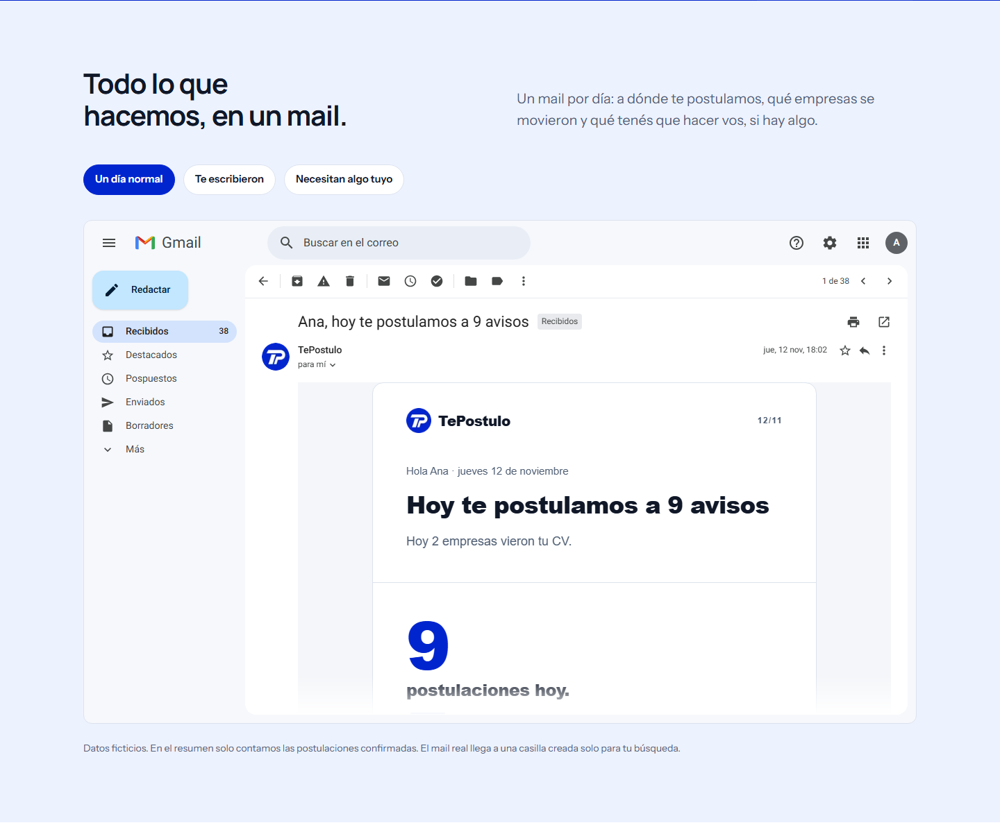

<p align="center">
  <a href="https://tepostulo.com.ar">
    
  </a>
</p>

<h1 align="center">TePostulo</h1>

<h3 align="center">Nos postulamos por vos.</h3>

<p align="center">
  Sitio público de <strong>TePostulo</strong>, un servicio de gestión de postulaciones laborales para CABA y Gran Buenos Aires:<br>
  buscamos avisos que encajan con el perfil de cada persona, adaptamos su CV y le contamos cada avance por mail.
</p>

<p align="center">
  <a href="https://tepostulo.com.ar"></a>
  <a href="https://github.com/sabbracciavento/te-postulo/actions/workflows/ci.yml"></a>
  
  
  
</p>

<p align="center">
  <a href="#qué-es-tepostulo">Qué es</a> ·
  <a href="#el-sitio">El sitio</a> ·
  <a href="#stack-y-decisiones-técnicas">Stack</a> ·
  <a href="#correr-el-proyecto">Correr el proyecto</a> ·
  <a href="#estructura">Estructura</a> ·
  <a href="#calidad">Calidad</a> ·
  <a href="#marca">Marca</a>
</p>

<p align="center">
  
</p>

---

## Qué es TePostulo

Buscar trabajo lleva tiempo: revisar avisos, adaptar el CV, escribir cartas, completar formularios y seguir respuestas.
**TePostulo hace esa parte por la persona.** Seleccionamos los avisos que encajan con su perfil, nos postulamos con un CV
y una carta pensados para cada uno, y le mandamos un resumen por mail con lo que hicimos y lo que avanzó.

- **Avisos que encajan**: filtro por rubro, zona, horario y sueldo; los dudosos se consultan.
- **Dos versiones del CV**: una para que la lea una persona y otra que entienden los sistemas de selección.
- **Cada postulación verificada**: solo se cuenta cuando quedó confirmada.
- **Casilla de búsqueda aparte**: no pedimos la contraseña del mail personal.

No garantizamos trabajo: las empresas deciden a quién entrevistan y contratan.

> Este repositorio contiene **solo el sitio público**.

| Plan | Qué incluye |
| --- | --- |
| **Base** | Todo el servicio: postulación diaria en portales de empleo y por mail, CV en dos versiones y carta por aviso, envío del CV a empresas que encajan aunque no tengan aviso, casilla de búsqueda, resumen diario, guía para el perfil de LinkedIn y avisos de LinkedIn numerados para que la persona se postule en 2 minutos. |
| **Plus** | Todo lo de Base y, además, la postulación en LinkedIn desde la cuenta de la persona, con su autorización. |

El precio depende del perfil y se consulta por WhatsApp o Instagram.

## El sitio

Una sola página, pensada para leerse en el celular en dos minutos, más la política de privacidad.

| Bloque | Qué resuelve |
| --- | --- |
| **Hero** | La promesa ("Nos postulamos por vos."), la bajada, los botones de WhatsApp e Instagram y el mismo mail en la compu y en el celular. En el celular, barra de contacto fija. |
| **Lo que hacemos por vos** | Tres fichas: avisos que encajan, dos versiones del CV, postulaciones verificadas. |
| **Cómo funciona** | Cuatro pasos (nos escribís por WhatsApp o Instagram, armamos tu perfil, postulamos por vos, recibís tu resumen) y lo que pedimos para empezar. |
| **Un caso real** | Avisos revisados, postulaciones verificadas y entrevistas de un caso inicial, con perfil, período y la aclaración de que los resultados no están garantizados. |
| **El mail** | Maqueta del resumen diario en Gmail (móvil y escritorio), con datos ficticios aclarados en una nota al pie. |
| **Planes** | Base y Plus, sin precios ni cuotas. |
| **Confianza** | "No necesitamos la contraseña de tu mail personal." y cómo se cuidan los datos. |
| **Preguntas frecuentes** | Once respuestas cortas a las dudas de siempre, LinkedIn incluido. |
| **Cierre** | "Contanos qué trabajo buscás." y los botones de WhatsApp e Instagram. |

<p align="center">
  
  &nbsp;&nbsp;&nbsp;
  
</p>

### El mail diario

Un resumen por día, pensado para leerse en un minuto. La maqueta es el mismo mail que recibe la persona, con datos ficticios:

1. **Título grande** con lo importante del día ("Hoy te postulamos a 9 avisos", "¡Tenés una entrevista con …!") y una frase.
2. **La entrevista**, si hay, en una placa cobalto con el día en grande y el botón para ver el aviso.
3. **La cifra del día**, enorme, con el trazo inclinado de la marca.
4. **"Para hacer hoy"**: lo que depende de la persona, en filas con su botón; los avisos para postularse con su cuenta van numerados.
   Si no hay nada (y no hay entrevista): "Hoy no tenés que hacer nada."
5. **A dónde te postulamos** como índice numerado, **novedades de empresas** con el estado en versalitas de color y **la búsqueda
   completa** en tres cifras.

<p align="center">
  
  &nbsp;&nbsp;&nbsp;
  
</p>

## Stack y decisiones técnicas

| Capa | Elección | Por qué |
| --- | --- | --- |
| Framework | **Next.js 16** (App Router, Turbopack) | Páginas estáticas, metadatos y la imagen Open Graph generada en el servidor con una sola herramienta. |
| Estilos | **Tailwind CSS v4** + `src/app/tokens.css` | Los tokens de marca (colores, fuentes, espacios, radios) viven en un solo archivo de variables CSS; Tailwind los toma con `@theme inline`. |
| Tipografía | **Manrope** (títulos) e **Instrument Sans** (texto), autoalojadas con `next/font` | Sin pedidos a terceros en tiempo de ejecución, sin salto de fuentes al cargar. |
| Logo | **Monograma TP en PNG**, derivado del archivo original de la marca | Se usa el dibujo original sin redibujarlo; la versión vectorial está pendiente. |
| Animación | Solo CSS: entrada del hero y cambio de pestaña del mail | Movimiento mínimo; respeta `prefers-reduced-motion`. |
| Contenido | Archivos en `src/content/` | Los componentes no tienen texto propio: todo lo que se lee se edita en un solo lugar. |
| Deploy | **Vercel** | Build en cada push, previews por pull request. |

Decisiones de producto reflejadas en el código:

- **Contacto por dos canales igual de válidos**: WhatsApp (con un mensaje precargado sin datos personales) e Instagram
  [@te.postulo](https://www.instagram.com/te.postulo/). Si falta el número de WhatsApp, en desarrollo el botón se ve deshabilitado.
- **Cifras con contexto**: las del caso inicial van siempre con perfil, período y la aclaración de resultados no garantizados.
- **Nada de formularios ni base de datos** en el sitio: menos superficie, menos datos personales en tránsito.

## Correr el proyecto

Requisitos: Node.js 22 o superior.

```bash
git clone https://github.com/sabbracciavento/te-postulo.git
cd te-postulo
npm install
cp .env.example .env.local      # completar las dos variables
npm run dev                     # http://localhost:3000
```

| Variable | Qué es |
| --- | --- |
| `NEXT_PUBLIC_WHATSAPP_NUMBER` | Número de WhatsApp en formato internacional sin "+". Para un celular argentino: `549` + código de área + número. En producción de Vercel es obligatorio: sin él, el build se detiene. |
| `NEXT_PUBLIC_SITE_URL` | URL pública del sitio, usada en metadatos, `sitemap.xml` y `robots.txt`. En Vercel, si falta, se usa el dominio de producción del proyecto. |

Otros comandos:

```bash
npm run build      # build de producción
npm run start      # servir el build en local
npm run lint       # ESLint
npx tsc --noEmit   # chequeo de tipos
```

## Estructura

```text
src/
├─ app/                     rutas, layout, tokens de marca, metadatos, íconos, imagen Open Graph, sitemap y robots
│  ├─ fonts/                Manrope e Instrument Sans estáticas para la imagen Open Graph (licencia OFL incluida)
│  └─ privacidad/           política de privacidad
├─ components/
│  ├─ layout/               Header, Footer, barra de acción móvil
│  ├─ sections/             los nueve bloques de la home
│  ├─ mail/                 maqueta de Gmail (móvil y escritorio) y el mail de resumen
│  └─ ui/                   logo, botones de contacto (WhatsApp e Instagram), bandera, íconos
└─ content/                 todos los textos del sitio (site, home, mail, privacidad)
public/brand/               monograma TP: círculo, TP sola (blanca y azul) y avatar cuadrado
docs/img/                   capturas usadas en este README
```

Para cambiar un texto se edita `src/content/`. Para cambiar un color, una fuente, un espacio o un radio, `src/app/tokens.css`.

## Calidad

- **CI en GitHub Actions**: lint, chequeo de tipos y build de producción en cada push y pull request.
- **Lighthouse** (móvil, build de producción en local): 93–95 rendimiento · 100 accesibilidad · 100 buenas prácticas · 100 SEO.
  En escritorio, 100 en las cuatro.
- **Accesibilidad**: enlace para saltar al contenido, foco visible, contraste AA calculado para cada par de colores de la
  marca, estados con ícono y texto (no solo color), un solo `h1`, soporte de `prefers-reduced-motion`.
- **Commits** siguiendo [Conventional Commits](https://www.conventionalcommits.org/es/) y versionado semántico
  ([CHANGELOG](CHANGELOG.md)).

## Marca

Los archivos del monograma están en [`public/brand/`](public/brand/): círculo azul con la TP blanca, la TP sola en blanco
(para fondos azules u oscuros) y en azul (para fondos claros), y el avatar cuadrado de 1080 px. Se derivan del PNG
original sin redibujarlo. No deformar, no rotar, no cambiar el dibujo.

| Color | Uso |
| --- | --- |
| Cobalto `#0025CE` | Logo, fondos institucionales, cifras |
| Azul acción `#2457F5` | Botones, enlaces, estados activos |
| Tinta `#101828` · Pizarra `#526176` | Texto principal y secundario |
| Hielo `#EDF2FF` · Nube `#F4F6F9` | Fondos de sección |

<p align="center">
  
</p>

## Contacto

- Sitio: [tepostulo.com.ar](https://tepostulo.com.ar)
- Consultas sobre el servicio: por WhatsApp o por Instagram, [@te.postulo](https://www.instagram.com/te.postulo/).
- Consultas sobre el código: abrí un [issue](https://github.com/sabbracciavento/te-postulo/issues).

## Licencia

El código de este sitio se publica bajo licencia [MIT](LICENSE). La marca, los textos y las imágenes de TePostulo
son propiedad de su autor y no están cubiertos por esa licencia. Las tipografías Manrope e Instrument Sans se
distribuyen bajo la SIL Open Font License ([Manrope](src/app/fonts/OFL-Manrope.txt), [Instrument Sans](src/app/fonts/OFL-InstrumentSans.txt)).
