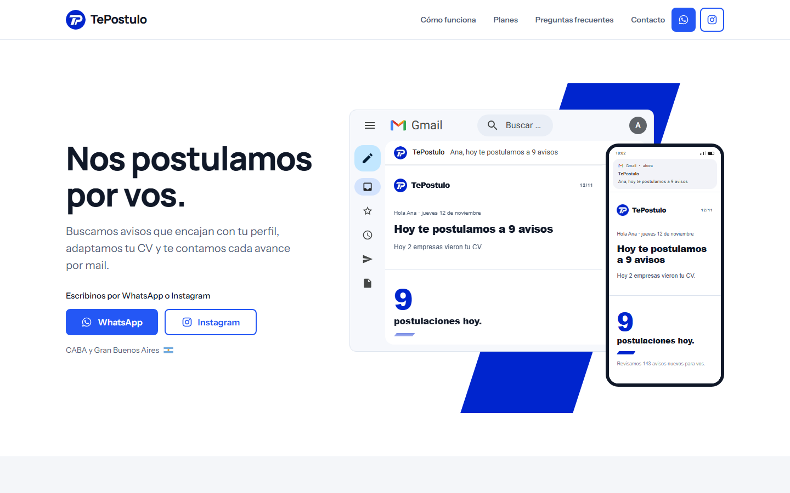
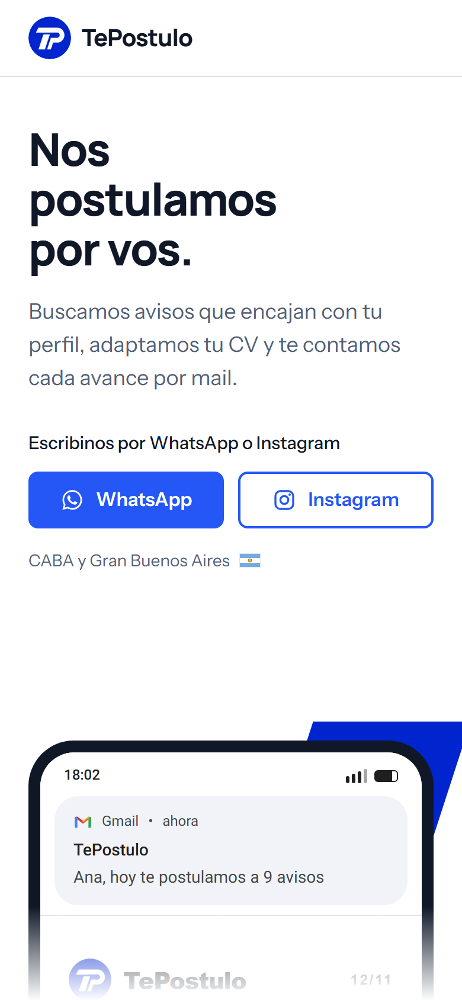

<p align="center"></p>

<h1 align="center">TePostulo</h1>

<p align="center"><strong>Landing de un servicio que se postula a empleos por la persona y le cuenta cada avance por mail.</strong></p>

<p align="center">
  <a href="https://tepostulo.com.ar"></a>
  
  
  
  
  <a href="LICENSE"></a>
</p>

<p align="center"><a href="https://tepostulo.com.ar"><strong>Ver el sitio en vivo →</strong></a></p>

<p align="center">
  
</p>

<p align="center">
  
  &nbsp;&nbsp;
  
</p>

---

## Sobre el proyecto

TePostulo es un servicio para personas que buscan trabajo en CABA y Gran Buenos Aires: selecciona avisos que encajan con su
perfil, se postula con un CV y una carta pensados para cada uno, y le manda un resumen diario por mail con lo hecho y lo que avanzó.
Este repositorio es el sitio público: una landing de una página, más la política de privacidad, pensada para leerse en el celular
en dos minutos y convertir en un mensaje por WhatsApp o Instagram.

## Lo destacado

- **Responsive con composiciones distintas por breakpoint, no solo apiladas.** En escritorio y tablet el hero muestra el mismo mail en
  dos dispositivos (una ventana de Gmail atrás y un celular entero adelante, en proporción real); en el celular, el teléfono asoma y se
  funde. La sección del mail usa una maqueta de Gmail de escritorio, un teléfono en tablet y el mail limpio a todo el ancho en el celular,
  con container queries para que el mismo componente se adapte al lugar donde se muestra.
- **Sistema de diseño con tokens.** Colores, tipografías, espacios y radios viven en un solo archivo de variables CSS
  (`src/app/tokens.css`) y Tailwind v4 los toma con `@theme inline`. Los componentes no tienen valores sueltos.
- **Tipografías self-hosted** (Manrope e Instrument Sans) con `next/font`: sin pedidos a terceros en tiempo de ejecución y sin salto
  de fuentes al cargar.
- **Accesibilidad (objetivo WCAG 2.2 AA).** Contraste calculado para cada par de colores, foco visible, enlace para saltar al contenido,
  pestañas ARIA completas (un solo tabindex activo, flechas, Inicio y Fin), acordeón nativo con `<details>`, objetivos táctiles de 44 px,
  estados con ícono y texto, y `prefers-reduced-motion`. Verificado con axe en 12 tamaños de pantalla, sin violaciones serias.
- **SEO.** Metadata por página, imagen Open Graph generada en el servidor (`next/og`), JSON-LD `Organization` y `FAQPage`, `sitemap.xml`,
  `robots.txt`, canonical y una 404 que no se indexa.
- **Rendimiento.** Lighthouse sobre producción (https://tepostulo.com.ar, 26/11/2026):

  | | Rendimiento | Accesibilidad | Buenas prácticas | SEO | LCP | CLS |
  | --- | ---: | ---: | ---: | ---: | ---: | ---: |
  | Móvil | 98 | 100 | 100 | 100 | 2,3 s | 0 |
  | Escritorio | 100 | 100 | 100 | 100 | 0,6 s | 0 |

- **Seguridad.** Cabeceras (`X-Content-Type-Options`, `Referrer-Policy`, `Permissions-Policy`, `X-Frame-Options`), `poweredByHeader`
  desactivado y un build de producción que se corta con un mensaje claro si falta una variable de entorno obligatoria. Sin formularios
  ni base de datos: el contacto es por enlace.
- **Contenido tipado, separado de la UI.** Todos los textos están en `src/content/` como objetos de TypeScript; los componentes solo
  presentan. Cambiar un texto no toca la interfaz.

<p align="center">
  
</p>

## Stack

| Capa | Elección |
| --- | --- |
| Framework | Next.js 16 (App Router, Turbopack), React 19 |
| Lenguaje | TypeScript 5 |
| Estilos | Tailwind CSS v4 con tokens en variables CSS |
| Tipografía | Manrope e Instrument Sans vía `next/font` |
| Calidad | ESLint, chequeo de tipos, Lighthouse, axe |
| Deploy | Vercel, dominio propio `tepostulo.com.ar` |

## Estructura

```text
src/
├─ app/            rutas, layout, tokens de diseño, metadatos, imagen Open Graph, sitemap, robots, 404 y privacidad
├─ components/
│  ├─ layout/      encabezado, pie y barra de contacto del celular
│  ├─ sections/    los bloques de la página (hero, cómo funciona, cifras, mail, planes, confianza, preguntas, cierre)
│  ├─ mail/        maquetas del mail: ventana de Gmail, teléfono y el resumen diario
│  └─ ui/          logo, botones de contacto, íconos, bandera
├─ content/        todos los textos del sitio, tipados
└─ lib/            utilidades (enlace de WhatsApp)
public/brand/      monograma y piezas de marca
```

## Correr el proyecto

Requisitos: Node.js 22 o superior.

```bash
git clone https://github.com/sabbracciavento/te-postulo.git
cd te-postulo
npm install
cp .env.example .env.local   # completar las variables
npm run dev                  # http://localhost:3000
```

| Variable | Qué es |
| --- | --- |
| `NEXT_PUBLIC_WHATSAPP_NUMBER` | Número de WhatsApp en formato internacional, sin "+" (Argentina: `549` + área + número). Obligatorio en producción. |
| `NEXT_PUBLIC_SITE_URL` | URL pública del sitio, para metadatos, `sitemap.xml` y `robots.txt`. En Vercel, si falta, se usa el dominio de producción del proyecto. |

```bash
npm run lint       # ESLint
npx tsc --noEmit   # tipos
npm run build      # build de producción
npm run start      # servir el build
```

## Deploy

Producción en Vercel, con el dominio propio `tepostulo.com.ar` (el `www` redirige al dominio principal). Las variables de entorno se
cargan en el proyecto de Vercel; si falta el número de WhatsApp en producción, el build no se publica.

## Autor

Diseñado y desarrollado por **Santiago Abbracciavento**: [github.com/sabbracciavento](https://github.com/sabbracciavento) ·
[s.abbracciavento@gmail.com](mailto:s.abbracciavento@gmail.com).

## Licencia

El código se publica bajo licencia [MIT](LICENSE). La marca, los textos y las imágenes de TePostulo no están cubiertos por esa licencia.
Las tipografías Manrope e Instrument Sans se distribuyen bajo la SIL Open Font License
([Manrope](src/app/fonts/OFL-Manrope.txt), [Instrument Sans](src/app/fonts/OFL-InstrumentSans.txt)).
