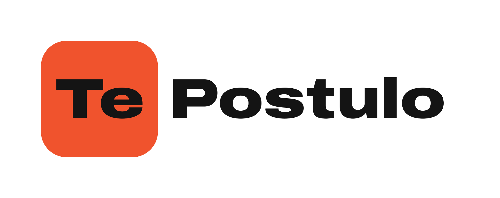
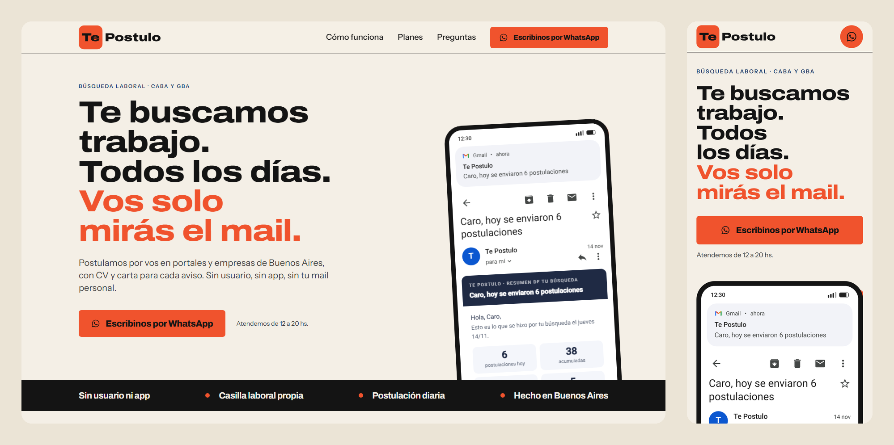
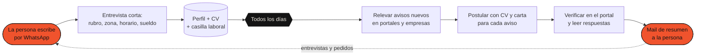
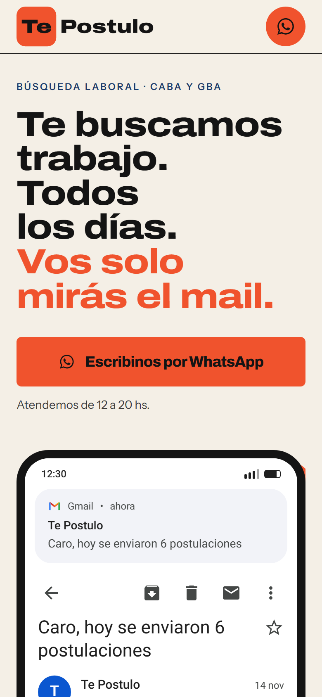
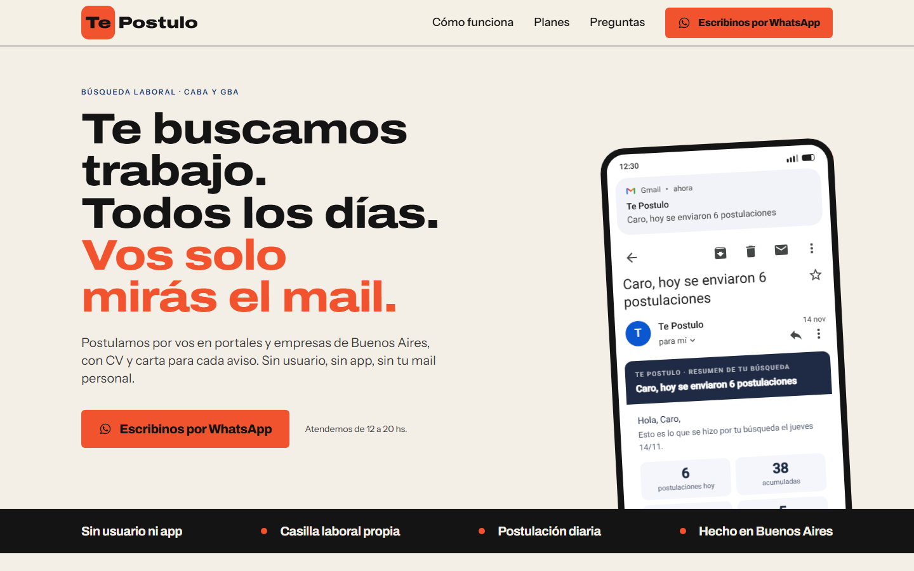
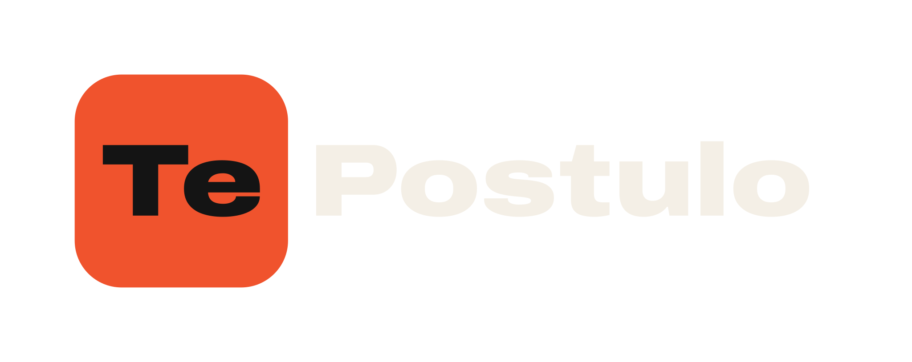

<p align="center">
  <a href="https://tepostulo.com.ar">
    <picture>
      <source media="(prefers-color-scheme: dark)" srcset="public/brand/logo-con-margen-oscuro.svg">
      
    </picture>
  </a>
</p>

<h3 align="center">Te buscamos trabajo. Todos los días. Vos solo mirás el mail.</h3>

<p align="center">
  Sitio público de <strong>Te Postulo</strong>, un servicio de búsqueda laboral asistida para Buenos Aires:<br>
  postulamos por vos en portales y empresas, con CV y carta para cada aviso, y te mandamos un resumen diario por mail.
</p>

<p align="center">
  <a href="https://tepostulo.com.ar"></a>
  <a href="https://github.com/sabbracciavento/te-postulo/actions/workflows/ci.yml"></a>
  
  
  
</p>

<p align="center">
  <a href="#qué-es-te-postulo">Qué es</a> ·
  <a href="#cómo-funciona-el-servicio">Cómo funciona</a> ·
  <a href="#el-sitio">El sitio</a> ·
  <a href="#stack-y-decisiones-técnicas">Stack</a> ·
  <a href="#correr-el-proyecto">Correr el proyecto</a> ·
  <a href="#estructura">Estructura</a> ·
  <a href="#calidad">Calidad</a> ·
  <a href="#contacto">Contacto</a>
</p>

<p align="center">
  
</p>

---

## Qué es Te Postulo

Buscar trabajo es un trabajo: abrir cinco portales por día, adaptar el CV a cada aviso, escribir la carta, cargar
formularios, seguir respuestas. **Te Postulo hace esa parte por la persona.** Un equipo con herramientas propias releva
los avisos nuevos de Buenos Aires todos los días, postula con un CV y una carta pensados para cada puesto, y la persona
recibe un único mail de resumen: qué se envió, a dónde y qué contestaron.

- **Sin usuario ni app.** El canal es el mail, el contacto es WhatsApp.
- **Casilla laboral propia.** Las postulaciones salen desde una casilla creada para la búsqueda, así el mail personal
  queda limpio y nada se pierde.
- **Postulación diaria y verificada.** Cada postulación queda registrada y se controla en el portal.
- **Hecho en Buenos Aires**, para CABA y GBA.

> Este repositorio contiene **solo el sitio público**. El sistema que hace las postulaciones es privado.

## Cómo funciona el servicio



| Plan | Qué incluye |
| --- | --- |
| **Base** | Postulación diaria en los portales principales, CV y carta por aviso, resumen por mail, seguimiento de respuestas. |
| **Plus** | Todo lo del plan Base más candidaturas espontáneas a empresas sin aviso publicado, con mail de contacto verificado. |

Los precios se conversan por WhatsApp según el rubro y la zona.

## El sitio

Una sola página, pensada para leerse en el celular en dos minutos, más la política de privacidad.

| Bloque | Qué resuelve |
| --- | --- |
| **Hero** | La promesa en tres líneas y el botón de WhatsApp. En móvil, una barra de acción fija. |
| **Barra de confianza** | Cuatro afirmaciones cortas en marquesina: sin usuario ni app, casilla propia, postulación diaria, hecho en Buenos Aires. |
| **Cómo funciona** | Tres pasos: escribís, armamos tu perfil, postulamos y te contamos. |
| **El mail** | Una maqueta fiel de Gmail (móvil y escritorio) con un resumen diario de ejemplo: cuántas postulaciones, a dónde, qué contestaron. Datos ficticios. |
| **Planes** | Base y Plus, con lo que incluye cada uno. |
| **Confianza** | Qué hacemos y qué no hacemos con los datos de la persona. |
| **Preguntas** | Las seis dudas que aparecen siempre en el primer mensaje. |
| **Cierre** | Último llamado a escribir, con el horario de atención. |

<p align="center">
  
  &nbsp;&nbsp;&nbsp;
  
</p>

## Stack y decisiones técnicas

| Capa | Elección | Por qué |
| --- | --- | --- |
| Framework | **Next.js 16** (App Router, Turbopack) | Páginas estáticas, metadatos y la imagen Open Graph generada en el servidor con una sola herramienta. |
| Estilos | **Tailwind CSS v4** con tokens en `@theme` | Paleta y tipografías declaradas una vez en CSS; los componentes no cargan valores sueltos. |
| Tipografía | **Archivo** (variable, eje de ancho) e **Instrument Sans**, autoalojadas con `next/font` | Sin pedidos a terceros en tiempo de ejecución, sin salto de fuentes al cargar. |
| Logo | **SVG con las letras en trazados**, generado desde la fuente con métricas reales | Mismo dibujo en header, favicon e imagen para redes; no depende de la carga de la fuente web. |
| Animación | **motion** con `LazyMotion` | Aparición por bloques y marquesina con la carga mínima; respeta `prefers-reduced-motion`. |
| Contenido | Archivos en `src/content/` | Los componentes no tienen texto propio: todo lo que se lee se edita en un solo lugar. |
| Deploy | **Vercel** | Build en cada push, previews por pull request, dominio `tepostulo.com.ar`. |

Decisiones de producto reflejadas en el código:

- **La maqueta de Gmail es idéntica al cliente real** (tipografía, iconos, espaciados) porque el mail *es* el producto:
  la persona tiene que reconocer en el sitio lo que va a recibir.
- **Un solo llamado a la acción** (WhatsApp) con mensaje prellenado: rubro, zona, horario y sueldo pretendido, para
  que la primera respuesta ya sirva.
- **Nada de formularios ni base de datos** en el sitio: menos superficie, menos datos personales en tránsito.

## Correr el proyecto

Requisitos: Node.js 22 o superior.

```bash
git clone https://github.com/sabbracciavento/te-postulo.git
cd te-postulo
npm install
cp .env.example .env.local      # completar las dos variables
npm run dev                     # http://localhost:3000
```

| Variable | Qué es |
| --- | --- |
| `NEXT_PUBLIC_WHATSAPP_NUMBER` | Número de WhatsApp en formato internacional sin "+". Para un celular argentino: `549` + código de área + número. |
| `NEXT_PUBLIC_SITE_URL` | URL pública del sitio, usada en metadatos, `sitemap.xml` y `robots.txt`. En producción: `https://tepostulo.com.ar`. |

Otros comandos:

```bash
npm run build      # build de producción
npm run start      # servir el build en local
npm run lint       # ESLint
npx tsc --noEmit   # chequeo de tipos
```

## Estructura

```text
src/
├─ app/                     rutas, layout, metadatos, favicon, imagen Open Graph, sitemap y robots
│  ├─ fonts/                fuentes autoalojadas (licencia OFL incluida)
│  └─ privacidad/           política de privacidad
├─ components/
│  ├─ layout/               Header, Footer, barra de acción móvil
│  ├─ sections/             los ocho bloques de la home
│  ├─ mail/                 maqueta de Gmail (móvil y escritorio) y el mail de resumen
│  ├─ motion/               aparición por bloques
│  └─ ui/                   Logo (SVG), botón de WhatsApp, etiquetas, marquesina
└─ content/                 todos los textos del sitio (site, home, mail, privacidad)
public/brand/               logo e isotipo en SVG, versiones para fondo claro y oscuro
docs/img/                   capturas usadas en este README
```

Para cambiar un texto se edita `src/content/`. Para cambiar un color o una tipografía, los tokens en
`src/app/globals.css`. Para regenerar el logo a partir de la fuente, la geometría está en
`src/components/ui/logo-geometry.ts` y se documenta en el propio archivo.

## Calidad

- **CI en GitHub Actions**: lint, chequeo de tipos y build de producción en cada push y pull request.
- **Lighthouse** (móvil): 91 rendimiento · 100 accesibilidad · 100 buenas prácticas · 100 SEO. En escritorio, 100 en las cuatro.
- **Accesibilidad**: enlace para saltar al contenido, foco visible, contraste verificado sobre naranja, orden de
  encabezados, soporte de `prefers-reduced-motion`, maqueta decorativa marcada como `inert`.
- **Commits** siguiendo [Conventional Commits](https://www.conventionalcommits.org/es/) y versionado semántico
  ([CHANGELOG](CHANGELOG.md)).

## Marca

Los archivos del logo están en [`public/brand/`](public/brand/): logo completo, versión para fondo oscuro, isotipo
("Te") y variantes con margen de seguridad. La "Te" va siempre en el cuadrado naranja; "Postulo" comparte altura de
letra y línea de base. No deformar, no rotar, no cambiar la tipografía.

<p align="center">
  
  
</p>

## Contacto

- Sitio: [tepostulo.com.ar](https://tepostulo.com.ar)
- Consultas sobre el servicio: por WhatsApp desde el sitio.
- Consultas sobre el código: abrí un [issue](https://github.com/sabbracciavento/te-postulo/issues).

## Licencia

El código de este sitio se publica bajo licencia [MIT](LICENSE). La marca, los textos y las imágenes de Te Postulo
son propiedad de su autor y no están cubiertos por esa licencia. Las tipografías Archivo e Instrument Sans se
distribuyen bajo la [SIL Open Font License](src/app/fonts/OFL-Archivo.txt).
